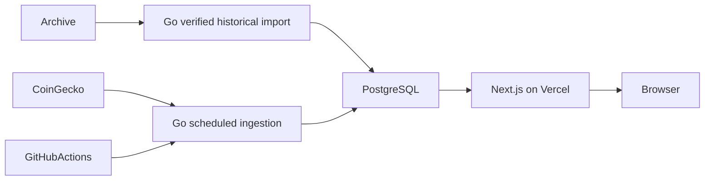

# Vercel platform migration

## Decisions
Next.js App Router in `web/` reads Neon PostgreSQL. Go owns CoinGecko ingestion,
daily sampled series, indicators and persisted analytics. GitHub Actions runs at
00:17 and 12:17 UTC. Vercel exclusively builds and hosts the website through its
Git integration. No Go request service or public ingestion endpoint is necessary.

## Audit
The previous command writes SQLite, README and Hugo JSON, then a scheduled
workflow commits those files and deploys Pages. Preserve domain calculations and
useful tests; replace persistence, orchestration, exporters and UI. Audit found
reversed indicator chronology, broken HTTP error retry classification, mixed
SQLite timestamp comparisons, flat-series numerical defects, false MA crossover
at exactly 200 points, and all-or-nothing consensus history requirements.

SQLite: 2,395 rows, 2,245 unique observations, 150 exact duplicate groups, no price
conflicts; five assets with 223 recorded days and only 97 consecutive recent days.
Legacy JSON has eleven extra assets with one observation each. Preserve all source
records with checksums and provenance before removing runtime exports.

## Technology and cost
Use stable Next.js/React, TypeScript strict, Tailwind, accessible Radix primitives,
Lightweight Charts and Recharts. npm lockfile fixes exact versions. Node 24 LTS.
Go uses pgx and Goose SQL migrations. PostgreSQL 17 locally and Neon in production.
Neon provides a small scale-to-zero PostgreSQL deployment without unused auth or
storage products. Supabase remains compatible but is unnecessary for this scope.
Vercel Services supports multiple runtimes but is beta and adds an unnecessary
request backend. Vercel Hobby cron only runs daily, hence GitHub scheduling.
Sources: https://vercel.com/docs/services, https://vercel.com/docs/services/pricing,
https://vercel.com/docs/cron-jobs/usage-and-pricing, https://neon.com/pricing,
https://supabase.com/pricing. Free-tier quotas are not a production SLA.

## Data semantics
Track top 25 plus the original five, deduplicated. Preserve delisted history.
Indicators consume ascending, consecutive completed UTC days, using the last
sample of each day; these are sampled prices, not exchange closing candles.
Never interpolate gaps or present observation counts as day counts. MA200 needs
200 consecutive days; crossover needs 201. Consensus uses available indicators
and reports coverage. Signal strength is heuristic, not a return probability.

Import is read-only at source, transactional, idempotent, and fails on invalid or
conflicting values. Preserve source rows and raw timestamps, including precision
beyond PostgreSQL microseconds. Verify counts, dates and values. Retain history
indefinitely. Archive inputs remain until external import and backups are verified.

## UI
Graphite/teal dark default, full light theme, readable tabular numbers, sidebar
and mobile navigation. Dashboard, explorer, coin details, watchlist and comparison
are complete vertical slices. Charts are real sampled data; empty, unavailable,
stale and partial states are explicit. Browser-local preferences require no login.
Comparison uses the first common completed date and leaves missing days as gaps.
No portfolio simulator in this release.

## Ordered implementation checklist
- [x] Phase 1: schema, local tooling, application skeleton, configuration
- [x] Phase 2: import, Go persistence, ingestion, corrected daily analytics
- [x] Phase 3: design system, dashboard, explorer, details and charts
- [x] Phase 4: watchlist, comparison, sorting, filtering and preferences
- [ ] Phase 5: unit/integration/browser tests, accessibility, production build
- [ ] Phase 6: legacy removal, documentation, grouped commits, draft PR

## Validation and definition of done
Go format/race tests/vet/build; real PostgreSQL import twice with reconciliation;
frontend formatting/lint/types/tests/build; browser desktop/mobile dark/light,
keyboard interactions, chart ranges, watchlist persistence and comparison;
empty/stale/partial/unavailable datasets; credentials absent from client bundles;
no legacy website deployment workflow. Capture actual outcomes in documentation.

## Rollout and rollback
Separate preview and production databases and roles. Never migrate during web
build. User provisions Neon and imports the repository into Vercel rooted at web.
Production activation and merge remain user-controlled. Scheduled workflows only
activate on the default branch and may be delayed. Preserve the original archive,
back up PostgreSQL, use additive migrations, and roll back website code through
Vercel without destructive schema rollback. Do not restore Pages as a host.

## Resume checkpoint
See [PROGRESS.md](PROGRESS.md) for current state and next actions, and
[VALIDATION.md](VALIDATION.md) for checks actually executed. Phase 5 has passing
baseline coverage with explicit remaining scenarios. Phase 6 repository cleanup
is implemented; review/CI and external deployment verification remain.
